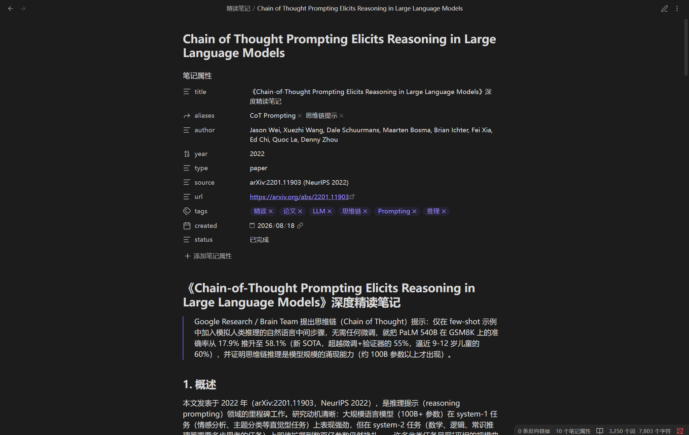

# deep-read-summarize

[English](https://github.com/PensiveFei/deep-read-summarize/blob/main/README.en.md) | [简体中文](https://github.com/PensiveFei/deep-read-summarize/blob/main/README.md)

[](https://github.com/PensiveFei/deep-read-summarize/blob/main/LICENSE)
[](https://github.com/PensiveFei/deep-read-summarize/releases)
[](https://github.com/PensiveFei/deep-read-summarize/actions/workflows/ci.yml)
[](https://www.npmjs.com/package/deep-read-summarize)

Turn a paper, book, video, or web page into a **Markdown reading note you can keep, edit, and check against the source**.

This third-party plugin runs in [DeepSeek Harness (DSH)](https://github.com/deepseek-ai/deepseek-harness). It attempts to retrieve the source text, reads long material in chunks, and combines the results into a structured note with YAML frontmatter. You can use the note in Obsidian, Logseq, or another Markdown tool.

[See real notes](#see-the-notes) · [Get started](#get-started) · [Quality and limitations](#quality-and-limitations) · [Common options](#common-options)

> AI-generated notes can omit or misinterpret information. Use them as a starting point for reading, and check important claims and quotations against the source.

## See the notes

- 📄 [Paper: Emotional Intelligence of Large Language Models](https://github.com/PensiveFei/deep-read-summarize/blob/main/examples/emotional-intelligence.md)
- 📄 [Paper: Chain-of-Thought Prompting](https://github.com/PensiveFei/deep-read-summarize/blob/main/examples/chain-of-thought.md)
- 🎬 [Video: Andrej Karpathy's introduction to LLMs](https://github.com/PensiveFei/deep-read-summarize/blob/main/examples/intro-to-llms-video.md)

These are historical notes supplied by the maintainer, in Chinese. The paper notes have records of early project runs; how the video note was generated has not been confirmed. Their model, project version, and runtime were not recorded, so they are not performance claims for the current release. Some quotations and timestamps have been spot-checked, and edits to the public copies are documented in the [examples guide](https://github.com/PensiveFei/deep-read-summarize/blob/main/examples/README.md).



## What it does

| You provide | The workflow attempts to retrieve | You receive |
| --- | --- | --- |
| A book: PDF, EPUB, MOBI | Text and chapters | A reading note organized by topic |
| A paper: arXiv, PDF, HTML | Paper text and structure | Research question, method, findings, and limitations |
| A video link | Subtitles first; local transcription when needed and available | A breakdown based on the text obtained |
| A web page | Page text | Key points, concepts, and source information |

Extraction depends on source accessibility, available tools, the model, and host permissions. Scanned PDFs generally need OCR first; the workflow does not provide automatic OCR. Complex formulas, diagrams, and poor-quality captions or audio may also need manual handling.

Notes typically include an overview, structural breakdown, glossary, key quotations, critical analysis, and applications. Their contents are model-generated and may differ between inputs and configurations.

## Get started

### 1. Install the plugin

Install and start DSH Desktop once to initialize its desktop profile. **Quit the application completely**, then use the DSH command bundled with Desktop to install the plugin:

```bash
dsh plugin --profile desktop add deep-read-summarize
```

Reopen DSH Desktop when installation finishes. The bundled command may not be on your system PATH; use `resources/runtime/cli/bin/dsh` inside the installation directory (`dsh.cmd` on Windows). Interfaces and commands can change between host versions; see the [official DSH Desktop instructions](https://github.com/deepseek-ai/deepseek-harness/blob/master/apps/desktop/README.md). Do not run `npm install` or `npm update` directly inside a DSH profile directory.

Deep reading also requires a working model and suitable permissions in DSH. Some sources need additional tools: PDF extraction may need `pdftotext`, YouTube captions may need `yt-dlp`, and local transcription of a video without subtitles may require `uv` and a transcription model.

### 2. Request a reading note

In a DSH conversation, for example:

```text
Please read this paper in depth and save a Markdown reading note:
https://arxiv.org/abs/2307.09042
```

You can also provide a local file, web page, or video link. If needed, specify an output location, sections to retain, or whether you want timestamps.

Hosts with plugin-tool support register `deep_read_summarize`; older hosts use the bundled skill and workflow entry point. The tool returns the note and a suggested path; **the main agent must write the file**. Check that the file was saved and whether the result reports gaps or quality issues.

When an identifiable note is extracted from a wrapper, the optional `draftContext` field records the extraction and retains any surrounding text. That text is not part of the note reviewed against the source.

<details>
<summary>Direct tool-call example</summary>

```json
{
  "input": "https://arxiv.org/abs/2307.09042",
  "type": "paper",
  "options": {
    "maxChunks": 4,
    "outputDir": "./output"
  }
}
```

`type` can be `auto`, `book`, `paper`, `video`, or `web`. Specifying it can skip classification for ambiguous inputs. The tool-call interface depends on the DSH host; asking in conversation is also supported.

</details>

## Quality and limitations

The workflow normalizes chunk ranges and checks coverage of known source line numbers. After drafting, code checks format and length, and an independent review agent reads the obtained text to check chunk coverage and key quotations. Results are available through `qualityPassed`, `qualityChecks`, and `qualityEvidence`.

These checks have limits:

- **`qualityPassed` does not prove factual accuracy.** Coverage and source authenticity still depend on the reviewing agent reading and evaluating the source. Check important claims, numbers, and quotations yourself.
- **Retrieving the full text does not guarantee understanding it.** Complex tables, formulas, images, or extraction errors can affect the result; incomplete sources or failed chunks are reported as gaps.
- **Captions and transcripts can differ from audio.** Automatic captions and speech recognition can omit words or mishear numbers and negations; checking the note against a transcript does not prove the transcript is accurate.
- **Video timestamps cannot be inferred reliably.** Locations depend on whether the obtained subtitles or transcript contain time information.

## Common options

| Option | Default | Purpose |
| --- | --- | --- |
| `minWords` | `2500` | Minimum length; the check counts Chinese characters and words in other text |
| `fastMode` | `false` | Omit the critical analysis, personal applications, and further-reading sections |
| `maxChunks` | `4` | Chunk-count limit, capped at 12; this is not the concurrency setting |
| `readConcurrency` | `3` | Maximum concurrent chunk reads; higher concurrency is not always faster |
| `maxRetries` | `0` | Repair attempts after a failed quality check; by default, a successfully drafted note receives one review and no repair |
| `outputDir` | `./output` | Suggested note directory; the main agent performs the write |
| `requireCitations` | `true` | Require verifiable source information for key quotations |
| `includeTimestamps` | `false` | Request timestamps for video notes |
| `transcribe` | `true` | Attempt local transcription when a video has no usable subtitles |
| `whisperModel` / `language` | `small` / `zh` | Choose a transcription model and language; set `en` for English when appropriate |
| `device` / `cpuThreads` | `cpu` / `0` | Select the transcription device and CPU thread policy |
| `transcriptCache` | `true` | Reuse validated transcripts when the audio and configuration match |
| `parallelQuality` | `false` | Opt in to parallel source review; the original review path remains the default |
| `readCache` | `false` | Optional cross-run chunk cache; supported by the plugin tool only |

To enable `readCache`, also set `readCacheIdentity` to include the provider, pinned model version, and output-affecting settings; change it whenever those change. The caller supplies this identity, and the host cannot verify it automatically. Cache entries are local plaintext and may contain source excerpts; cache hits still receive independent source review.

Other options include `frontmatter` (`obsidian`, `generic`, or `minimal`) and `tempDir`. See the [advanced reference](https://github.com/PensiveFei/deep-read-summarize/blob/main/docs/README-reference.en.md) for detailed options, supported formats, and transcription and cache behavior.

## Time, cost, and privacy

- **Time** depends on content length, retrieval, chunk count, model, and host concurrency. A video without subtitles needs extra transcription; the first run may also download a transcription model.
- **Cost** depends on your model and input/output usage; the project cannot promise fixed time or cost.
- **Privacy:** speech transcription runs locally, but deep reading uses your configured DSH model. With a cloud model, source text, subtitles, notes, or related context may be sent to its provider; check its data-handling terms first.
- **Local files:** temporary source text, transcripts, and optional caches may remain on your device. Check directory permissions and cleanup before processing sensitive material.

## Troubleshooting

- **Plugin unavailable:** check the DSH profile, restart Desktop after installation, and check host-version compatibility.
- **Fetch failure or missing sections:** check source accessibility and required tools; inspect the returned stage, source status, and failed chunks.
- **Only a video description is available:** a complete subtitle or transcript has not been confirmed. Check subtitle and transcription availability, or provide a transcript.
- **Quality check failed:** inspect `qualityIssues` and `qualityEvidence` and review the source as needed. Do not treat an unverified note as a complete account.

For further help, [open a GitHub issue](https://github.com/PensiveFei/deep-read-summarize/issues) with your operating system, DSH and plugin versions, input type, and error details. Remove secrets, private links, and personal data first.

## Development and contributing

Work in a **separate project directory**; do not run npm inside a DSH profile:

```bash
git clone https://github.com/PensiveFei/deep-read-summarize.git
cd deep-read-summarize
npm ci
npm test
npm run test:node
npm run lint
npm run validate
```

The project uses parsers for different input types and supports custom parsers. See the [repository](https://github.com/PensiveFei/deep-read-summarize), [CHANGELOG](https://github.com/PensiveFei/deep-read-summarize/blob/main/CHANGELOG.md), and [CONTRIBUTING](https://github.com/PensiveFei/deep-read-summarize/blob/main/CONTRIBUTING.md).

The relevant host contracts were previously verified with DSH `0.2.0-rc.2`. DSH interfaces can change; verify other versions against the actual host and compatibility information.

## License and disclaimer

Project code is available under the [MIT License](https://github.com/PensiveFei/deep-read-summarize/blob/main/LICENSE). Papers, video, and short quotations cited in examples remain subject to their respective rights and permissions.

deep-read-summarize is an independent third-party project. It is not affiliated with, endorsed by, or sponsored by DeepSeek or DeepSeek Harness.
