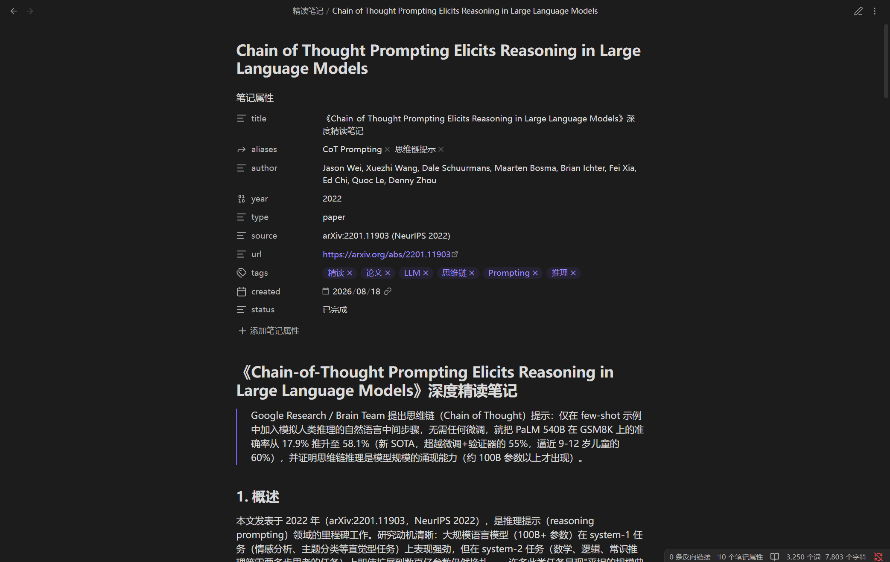

# deep-read-summarize

[English](https://github.com/PensiveFei/deep-read-summarize/blob/main/README.en.md) | 简体中文

[](https://github.com/PensiveFei/deep-read-summarize/blob/main/LICENSE)
[](https://github.com/PensiveFei/deep-read-summarize/releases)
[](https://github.com/PensiveFei/deep-read-summarize/actions/workflows/ci.yml)
[](https://www.npmjs.com/package/deep-read-summarize)

把论文、书籍、视频或网页整理成一份**可以继续阅读、编辑和回查的 Markdown 笔记**。

这是一个运行在 [DeepSeek Harness（DSH）](https://github.com/deepseek-ai/deepseek-harness) 中的第三方精读插件。它尝试获取来源全文，将长内容分块阅读，再合并成带 YAML frontmatter 的结构化笔记。你可以把结果放进 Obsidian、Logseq 或其他 Markdown 工具。

[先看真实笔记](#看看笔记) · [安装与第一次使用](#开始使用) · [了解质量与限制](#结果能信到什么程度) · [常用配置](#常用配置)

> AI 笔记可能遗漏或误解原文。请把它作为辅助阅读的起点，关键事实与引用仍需对照来源。

## 看看笔记

- 📄 [论文：大语言模型的情绪智力](https://github.com/PensiveFei/deep-read-summarize/blob/main/examples/emotional-intelligence.md)
- 📄 [论文：Chain-of-Thought Prompting](https://github.com/PensiveFei/deep-read-summarize/blob/main/examples/chain-of-thought.md)
- 🎬 [视频：Andrej Karpathy 的 LLM 入门讲座](https://github.com/PensiveFei/deep-read-summarize/blob/main/examples/intro-to-llms-video.md)

这些是维护者提供的历史笔记：两篇论文有早期项目运行记录，视频笔记的生成方式尚未确认。模型、项目版本和运行耗时未记录，它们不是当前版本的性能承诺。部分引文和时间戳已抽查、并标注了公开副本的修改；详见[示例说明](https://github.com/PensiveFei/deep-read-summarize/blob/main/examples/README.md)。



## 它能做什么

| 你提供 | 工作流尝试获取 | 你得到 |
| --- | --- | --- |
| 书籍：PDF、EPUB、MOBI | 文本和章节 | 按主题整理的阅读笔记 |
| 论文：arXiv、PDF、HTML | 论文正文和结构 | 研究问题、方法、结论与局限 |
| 视频链接 | 优先字幕；无字幕时可尝试本地转写 | 基于已取得文本的内容拆解 |
| 网页链接 | 页面正文 | 要点、概念和来源信息 |

实际提取结果取决于来源是否可访问、工具是否可用、模型和宿主权限。扫描版 PDF 通常需要先进行 OCR，工作流不内置自动 OCR；复杂公式、图表以及质量差的字幕或音频可能需要人工处理。

笔记通常包含概述、结构拆解、术语表、关键引用、批判性分析和应用思考。最终内容仍由模型生成，不同输入和配置可能产生不同结果。

## 开始使用

### 1. 安装插件

先安装并启动一次 DSH Desktop，让它初始化桌面 profile；然后**完全退出应用**，使用 Desktop 随附的 DSH 命令安装：

```bash
dsh plugin --profile desktop add deep-read-summarize
```

安装完成后重新打开 DSH Desktop。随附命令不一定在系统 PATH 中：可使用安装目录下 `resources/runtime/cli/bin/dsh`（Windows 为 `dsh.cmd`）。界面和命令可能随宿主版本变化，详见 [DSH Desktop 官方说明](https://github.com/deepseek-ai/deepseek-harness/blob/master/apps/desktop/README.zh.md)。请勿在 DSH profile 目录中直接运行 `npm install` 或 `npm update`。

运行精读还需要 DSH 中可用的模型和相应权限；不同来源可能需要额外工具。例如 PDF 文本提取可能需要 `pdftotext`，YouTube 字幕获取可能需要 `yt-dlp`，无字幕视频的本地转写可能需要 `uv` 和转写模型。

### 2. 发起一次精读

在 DSH 对话中输入，例如：

```text
请帮我精读这篇论文，并生成一份 Markdown 阅读笔记：
https://arxiv.org/abs/2307.09042
```

你也可以提供本地文件路径、网页或视频链接。如果需要，可以在请求中说明输出位置、希望保留的章节或是否需要时间戳。

支持插件工具的宿主会注册 `deep_read_summarize`；旧宿主使用插件提供的技能和 workflow 入口。精读工具返回笔记正文及建议路径，**实际写入文件需要由主代理完成**。生成后请确认文件已保存，并检查结果中是否报告内容缺口或质量问题。

<details>
<summary>直接调用工具的参数示例</summary>

```json
{
  "input": "https://arxiv.org/abs/2307.09042",
  "type": "paper",
  "options": {
    "maxChunks": 4,
    "outputDir": "./output"
  }
}
```

`type` 可选 `auto`、`book`、`paper`、`video` 或 `web`。显式指定类型可以跳过部分模糊输入的识别步骤。具体工具调用方式取决于 DSH 宿主；也可以直接在对话里表达需求。

</details>

## 结果能信到什么程度？

工作流会规范化分块范围，检查已知原文行号的覆盖情况；成稿后，程序检查格式和篇幅，并由独立核验代理读取取得的文本，检查分块覆盖与关键引文。核验结果可通过 `qualityPassed`、`qualityChecks` 和 `qualityEvidence` 查看。

这些检查有边界：

- **`qualityPassed` 不是事实正确性的证明。**覆盖和原文真实性判断仍依赖核验代理实际读取与判断；重要结论、数字和引用请自行复核。
- **取得全文不等于理解了全文。**复杂表格、公式、图片以及提取错误可能影响结果；来源不完整或分块失败时，结果会报告缺口。
- **字幕或转写不等于音频原文。**自动字幕和语音识别可能漏句、听错数字或否定词；核验笔记与逐字稿不能证明逐字稿本身准确。
- **视频时间戳不能凭空推算。**可定位性取决于取得的字幕或转写是否包含时间信息。

## 常用配置

| 选项 | 默认值 | 用途 |
| --- | --- | --- |
| `minWords` | `2500` | 最低篇幅要求；检查规则按中文字符和其他文字的词计算 |
| `fastMode` | `false` | 开启后省略批判性分析、个人应用和延伸阅读章节 |
| `maxChunks` | `4` | 分块数量上限，最大为 12；不是并发数 |
| `readConcurrency` | `3` | 精读并发上限；并发更高不一定更快 |
| `maxRetries` | `0` | 未通过质量检查时的修订次数；成稿成功后默认执行一次核验，不做修订 |
| `outputDir` | `./output` | 建议的笔记输出目录，由主代理完成写入 |
| `requireCitations` | `true` | 要求关键引用具备可核验的来源信息 |
| `includeTimestamps` | `false` | 视频笔记是否要求时间戳 |
| `transcribe` | `true` | 视频没有可用字幕时，尝试本地转写 |
| `whisperModel` / `language` | `small` / `zh` | 选择转写模型和语言；英文视频可显式指定 `en` |
| `device` / `cpuThreads` | `cpu` / `0` | 选择转写设备和 CPU 线程策略 |
| `transcriptCache` | `true` | 相同音频及匹配配置时复用已验证的转写缓存 |
| `parallelQuality` | `false` | 显式启用并行原文核验；默认保留原核验路径 |
| `readCache` | `false` | 可选的跨次精读缓存；仅插件工具入口支持 |

开启 `readCache` 时，还必须提供 `readCacheIdentity`，写明供应商、固定模型版本及影响输出的设置；这些信息变化时需更换身份。该身份由调用者提供，宿主无法自动验证。缓存为本地明文，可能包含原文摘录；命中后仍会执行独立原文核验。

其他选项包括 `frontmatter`（`obsidian`、`generic`、`minimal`）和 `tempDir`。高级选项、取值范围、转写缓存和自定义解析器可参考[完整配置与技术参考](https://github.com/PensiveFei/deep-read-summarize/blob/main/docs/README-reference.zh.md)。

## 时间、费用与隐私

- **时间**取决于内容长度、获取方式、分块数量、模型和宿主并发。没有字幕的视频需要额外转写，首次使用还可能下载转写模型。
- **费用**取决于你配置的模型、输入与输出量；本项目不能保证固定的耗时或费用。
- **隐私**：本地语音转写在本机运行，但后续精读使用你在 DSH 中配置的模型。若使用云端模型，原文、字幕、笔记或相关上下文可能发送给对应服务商；请先确认其数据处理条款。
- **本地文件**：临时原文、转写和可选缓存可能保存在设备上；处理敏感资料前请确认目录权限与清理方式。

## 出问题时

- **插件不可用**：确认已在正确的 DSH profile 安装、重启了桌面应用，并检查宿主版本和插件兼容信息。
- **获取失败或笔记缺段**：确认链接可访问、所需工具已安装；查看返回的阶段、来源状态和失败分块。
- **只有视频简介**：说明没有取得可确认的完整字幕或逐字稿；请检查字幕与转写条件，或提供文本。
- **质量检查未通过**：查看 `qualityIssues` 和 `qualityEvidence`，必要时对照原文修订；不要把未核实的笔记当作完整结论。

仍有问题？欢迎在 [GitHub Issues](https://github.com/PensiveFei/deep-read-summarize/issues) 提供操作系统、DSH 与插件版本、输入类型和错误信息。请先去掉密钥、私有链接和个人资料。

## 开发与贡献

源码开发请在**独立的项目目录**进行，而不是在 DSH profile 目录运行 npm：

```bash
git clone https://github.com/PensiveFei/deep-read-summarize.git
cd deep-read-summarize
npm ci
npm test
npm run test:node
npm run lint
npm run validate
```

项目使用解析器处理不同输入类型，支持自定义解析器。代码和测试见[仓库](https://github.com/PensiveFei/deep-read-summarize)，版本变化见 [CHANGELOG](https://github.com/PensiveFei/deep-read-summarize/blob/main/CHANGELOG.md)，贡献方式见 [CONTRIBUTING](https://github.com/PensiveFei/deep-read-summarize/blob/main/CONTRIBUTING.md)。

**兼容性：**本项目此前验证过 DSH `0.2.0-rc.2` 的相关宿主契约；DSH 接口可能变化，其他版本请以实际测试和兼容说明为准。

## 版权与声明

项目代码采用 [MIT License](https://github.com/PensiveFei/deep-read-summarize/blob/main/LICENSE)。示例中引用的论文、视频和短引文仍受其各自权利与授权条件约束。

deep-read-summarize 是独立的第三方项目，与 DeepSeek 或 DeepSeek Harness 官方没有隶属、认可或赞助关系。
